# Laboratorio: gobierno del dato con OpenMetadata

OpenMetadata es una plataforma de código abierto para **catalogar, documentar, clasificar y gobernar** los datos
de una organización. En este laboratorio levantas OpenMetadata con Docker Compose, conectas bases de datos reales
y aplicas, paso a paso, las prácticas habituales de gobierno del dato: documentación, clasificación de datos
personales (RGPD), glosario de negocio, propiedad, calidad y linaje.

Referencia oficial: https://docs.open-metadata.org/latest/quick-start/local-docker-deployment

## Índice

| Módulo | Tema | Duración aprox. |
|---|---|---|
| 0 | Preparación y arranque del entorno | 10 min |
| 1 | Conceptos clave | 10 min |
| 2 | Tu primer catálogo: conectar MySQL | 20 min |
| 3 | Un caso realista: la base de datos Sakila | 10 min |
| 4 | Documentación | 15 min |
| 5 | Clasificación de datos personales (PII) | 15 min |
| 6 | Glosario de negocio | 15 min |
| 7 | Propiedad y dominios | 10 min |
| 8 | Calidad del dato | 20 min |
| 9 | Linaje | 25 min |
| 10 | Uso diario: la portada y el Centro de contexto | 15 min |
| 11 | Airflow: cuándo mirarlo y dónde | 10 min |
| 12 | Automatización y prueba E2E | 10 min |
| 13 | Ejercicios finales | 30 min |
| 14 | Solución de problemas y referencia | consulta |

## Cómo usar este laboratorio

Cada módulo sigue la misma estructura:

1. **Objetivo**: qué vas a aprender.
2. **Conceptos**: la teoría imprescindible.
3. **Hazlo a mano**: pasos numerados en la consola web. Es la parte formativa: haz esto primero.
4. **Atajo con script**: el mismo resultado, automatizado por API, sobre toda la base de datos Sakila.
5. **Comprobación**: cómo verificar que el módulo está completo.

> Recomendación: haz los pasos manuales sobre la tabla pequeña `clientes` (módulo 2) y después lanza el script
> para ver el mismo concepto aplicado a las 23 tablas y vistas de Sakila.

Los scripts están numerados en el orden del laboratorio, son **idempotentes** (puedes repetirlos) y deben
lanzarse desde esta carpeta. Si te pierdes, `./91_e2e_verificar.sh` (solo lectura) te dice qué módulos están completos.

---

## Módulo 0. Preparación y arranque del entorno

**Objetivo:** tener OpenMetadata y Airflow funcionando en local.

**Requisitos**
- Docker y Docker Compose.
- Unos 6 GB de RAM libres (orientativo: Elasticsearch, MySQL, OpenMetadata y Airflow).
- Puertos libres en tu máquina: `8585`, `8586`, `8080`, `9200`.
- `curl` y `python3` (los usan los scripts).

**Pasos**
1. Arranca el stack:
   ```bash
   ./01_launch.sh
   ```
2. Espera. La primera vez descarga imágenes y migra la base de datos: **de 3 a 5 minutos**, no te desesperes.
   Sigue el estado con `./02_ps.sh` o los logs con `./03_logs.sh`.
3. Cuando todo esté `healthy`, abre las consolas:
   ```bash
   ./04_open_openmetadata.sh   # http://localhost:8585
   ./05_open_airflow.sh        # http://localhost:8080
   ```

**URLs y credenciales** (válidas solo para este entorno de pruebas local)

| Servicio | URL | Usuario | Contraseña |
|---|---|---|---|
| OpenMetadata (consola) | http://localhost:8585 | `admin@open-metadata.org` | `admin` |
| Airflow | http://localhost:8080 | `admin` | `admin` |
| Elasticsearch | http://localhost:9200 | sin autenticación | sin autenticación |
| Healthcheck de OpenMetadata | http://localhost:8586/healthcheck | sin autenticación | sin autenticación |

MySQL **no se publica** en el host (evita choques con otros MySQL locales). Solo es accesible desde la red del
compose (`mysql:3306`) o con `docker exec -it openmetadata_mysql mysql -u root -ppassword`.

| Uso | Usuario | Contraseña | Base de datos |
|---|---|---|---|
| Administración | `root` | `password` | - |
| OpenMetadata | `openmetadata_user` | `openmetadata_password` | `openmetadata_db` |
| Airflow | `airflow_user` | `airflow_pass` | `airflow_db` |

**Parar y borrar**
- `docker compose down`: detiene y elimina contenedores y redes (los datos se conservan).
- `./99_destroy.sh`: además borra volúmenes y `docker-volume/db-data`. **Es destructivo**: vuelves a empezar de cero.

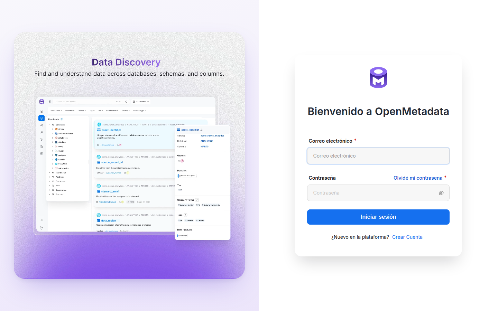

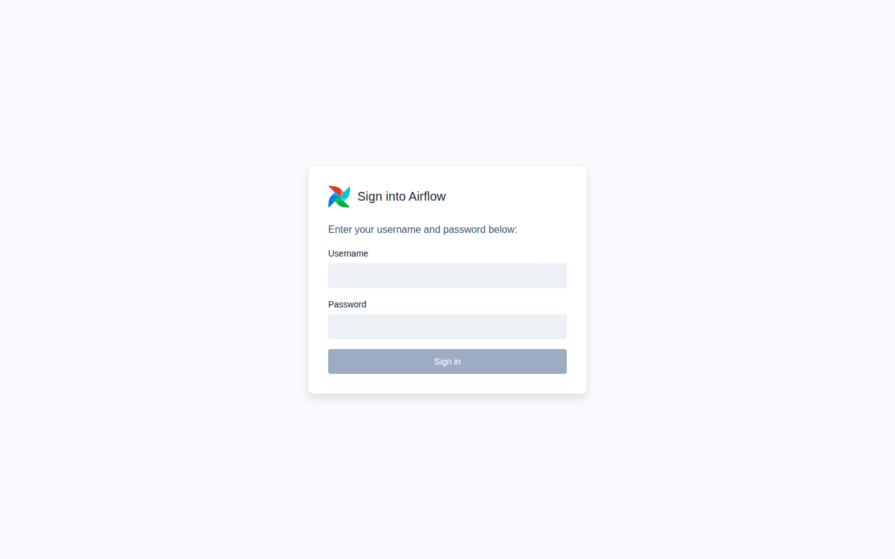

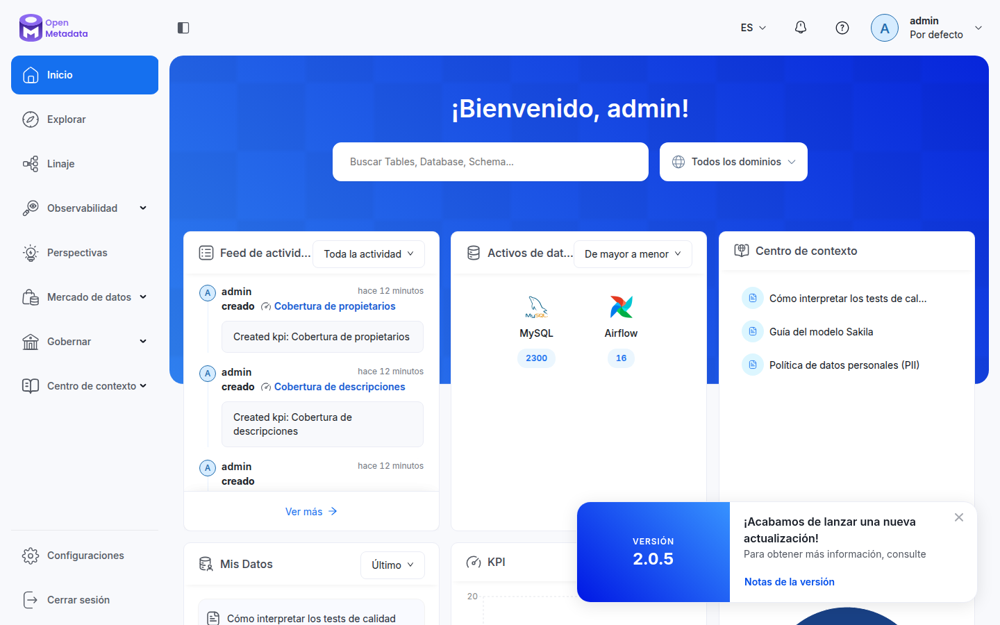

**Comprobación:** ambas consolas cargan y puedes iniciar sesión.

---

## Módulo 1. Conceptos clave

**Objetivo:** entender las piezas antes de tocar nada.

```
 Bases de datos  ──ingestión──▶  OpenMetadata  ◀──── tú (UI / API)
 (MySQL, ...)    (pipelines)     catálogo + gobierno
                       │                ▲
                       ▼                │
                    Airflow ────────────┘   ejecuta las pipelines y reporta el resultado
```

| Concepto | Qué es |
|---|---|
| **Metadato** | Información sobre los datos: nombre de tabla, columnas, tipos, descripción, propietario... |
| **Servicio** | Conexión a un sistema externo (una base de datos MySQL, un Airflow...). Es la fuente de los metadatos. |
| **Ingestión** | Proceso que lee un servicio y vuelca sus metadatos en OpenMetadata. |
| **Pipeline** | Una ingestión (o un test de calidad) programada. Se registra como un **DAG en Airflow**, que es quien la ejecuta. |
| **Activo** | Cualquier cosa catalogada: tabla, vista, pipeline, dashboard... |
| **Gobierno del dato** | Prácticas para que los datos sean comprensibles, seguros y fiables: documentar, clasificar, asignar responsables, medir calidad, trazar el origen. |

El flujo real de una pipeline:
1. Configuras una ingestión o un test en OpenMetadata.
2. OpenMetadata crea la pipeline y la **registra como DAG en Airflow**.
3. Airflow la ejecuta (a demanda o según su frecuencia).
4. El resultado se refleja en OpenMetadata.

**Comprobación:** puedes explicar con tus palabras qué diferencia hay entre un servicio y una pipeline.

---

## Módulo 2. Tu primer catálogo: conectar MySQL

**Objetivo:** conectar una base de datos y ver sus tablas en el catálogo.

**Conceptos:** un *servicio de base de datos* + una *pipeline de metadatos* = tablas catalogadas.

**Prepara los datos**
```bash
./06_create_clientes_table.sh
```
Crea en `openmetadata_db` la tabla `clientes` con 5 filas de prueba (una con el email a `NULL`, a propósito) y da
permisos de lectura del `general_log` a `openmetadata_user`.

**Hazlo a mano**
1. Entra en la consola de OpenMetadata.
2. Menú **Configuraciones -> Servicios -> Bases de datos** y pulsa **Añadir nuevo Servicio**.
   (Es el asistente de 3 pasos: *Seleccionar tipo de servicio*, *Connect* y *What to Ingest*.)
3. En el primer paso elige **MySQL** y pulsa Siguiente. Ponle un nombre, por ejemplo `MySQL OpenMetaData`.
4. En el paso *Connect* configura la conexión:
   - Usuario: `openmetadata_user`
   - Contraseña: `openmetadata_password`
   - Host y puerto: `mysql:3306`
   - Base de datos y esquema: `openmetadata_db`
5. Pulsa **Probar conexión**: debe salir todo en verde. Después **Ok** y **Siguiente**.
6. En el paso *What to Ingest* deja vacíos los patrones de inclusión/exclusión (incluye todo) y pulsa **Save**.
7. Aparecerá una pipeline de metadatos en estado pendiente. Déjala que se ejecute.
8. Ve a **Explorar**, en el árbol de la izquierda **Bases de datos -> mysql -> ...** (o busca `clientes` en la barra superior).

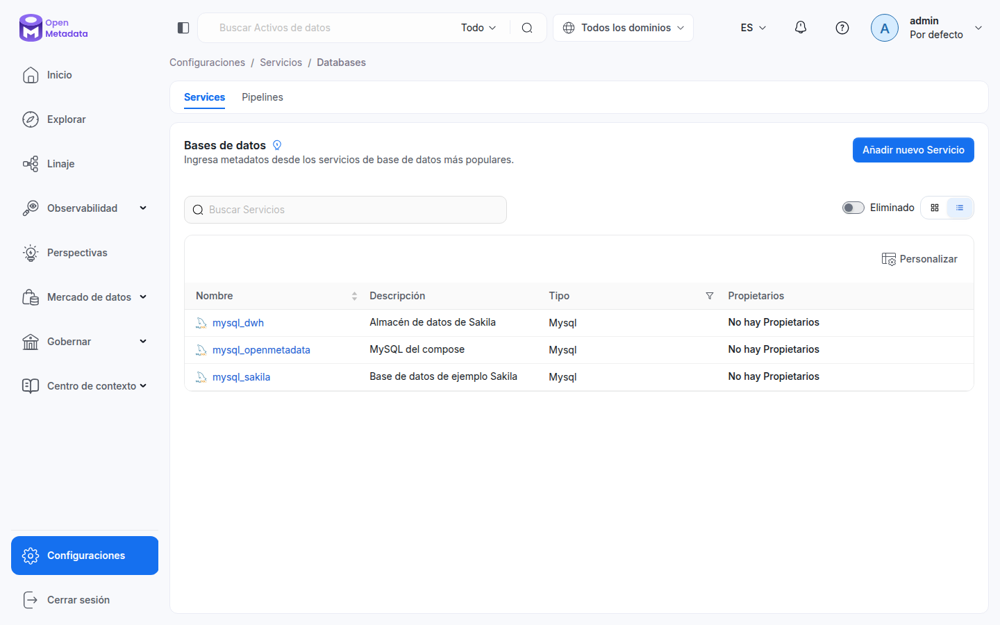

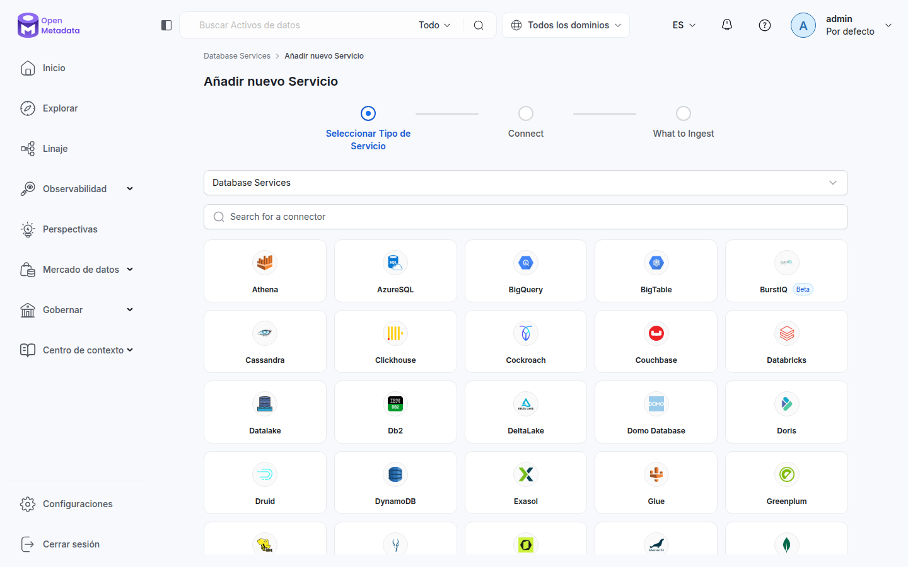

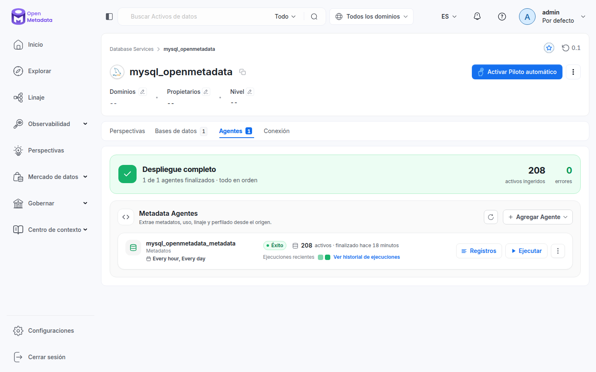

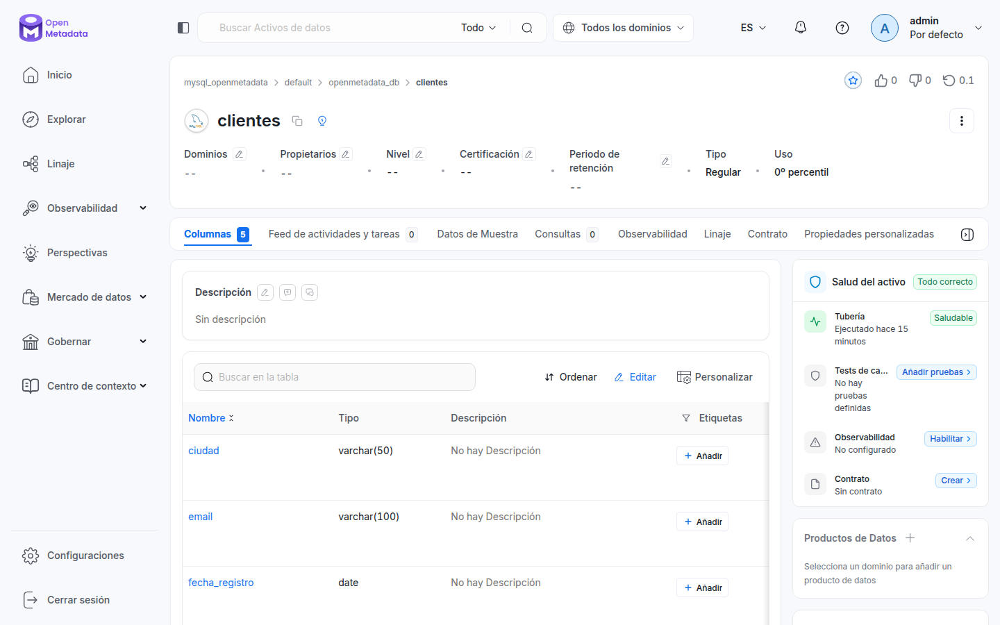


**Atajo con script** (hace lo mismo por API y crea el servicio `mysql_openmetadata`)
```bash
./07_ingest_mysql.sh
```

**Qué mirar**
- En OpenMetadata, ficha del servicio -> pestaña **Agentes**: la pipeline pasa a *Éxito* y la tabla `clientes`
  aparece con sus 5 columnas.
- En Airflow (http://localhost:8080): un DAG con el nombre de la pipeline y una ejecución en verde. Al entrar en la
  ejecución verás la tarea `ingestion_task` y su log. No termina hasta que pone *Done*.

**Comprobación:** `./91_e2e_verificar.sh 07` -> 2 PASS.

> **Pregunta:** ¿qué pasaría si añades filas a `clientes`? ¿Se actualiza el catálogo solo? (Pista: la pipeline solo se
> ejecuta según su programación, o cuando la lanzas a mano.)

---

## Módulo 3. Un caso realista: la base de datos Sakila

**Objetivo:** tener un modelo con relaciones, vistas y datos suficientes para practicar gobierno.

**Conceptos:** [Sakila](https://dev.mysql.com/doc/sakila/en/) modela un videoclub con varias tiendas: 16 tablas
y 7 vistas (clientes, películas, alquileres, pagos, empleados...).

**Atajo con script** (aquí no hay versión manual: es preparación de datos)
```bash
./08_load_sakila.sh
```
El script:
1. Descarga `sakila-db.tar.gz` de `downloads.mysql.com` y lo descomprime en un directorio temporal.
2. Carga el esquema y los datos en el MySQL del compose.
3. Da permisos de lectura sobre `sakila` a `openmetadata_user`.
4. Registra por API el servicio `mysql_sakila`, crea su pipeline de metadatos, la despliega y la lanza.

**Qué mirar:** **Explorar**, árbol **Bases de datos -> `mysql_sakila` -> `default` -> `sakila`** (tarda uno o dos minutos).
Deberías ver 23 tablas y vistas. Entra en `customer` y `rental` y fíjate en las columnas.

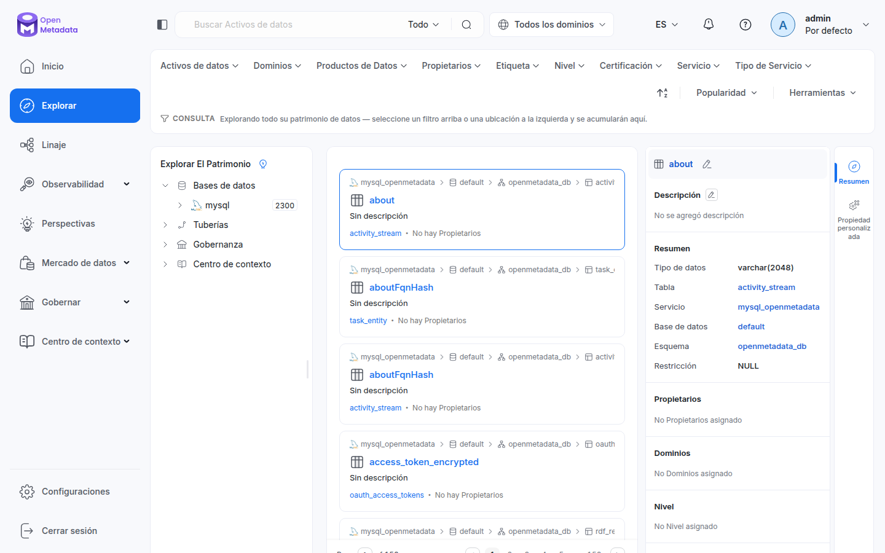


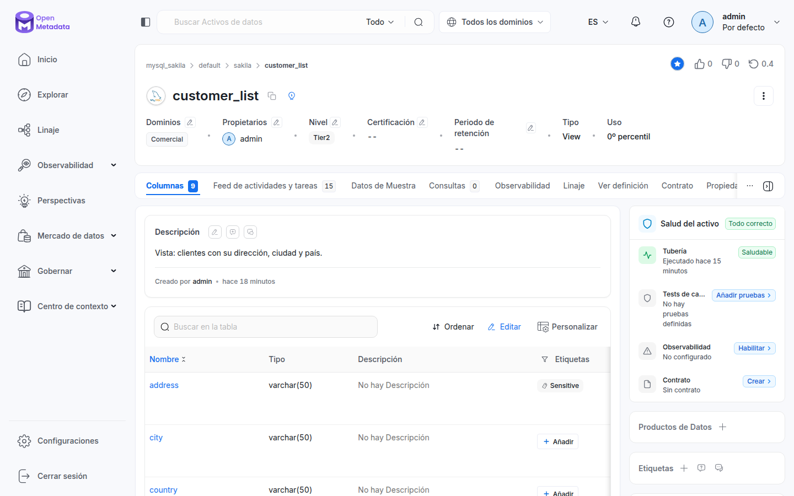

En las **vistas** aparece una pestaña extra, **Ver definición**, con el SQL de la vista.

**Comprobación:** `./91_e2e_verificar.sh 08` -> 2 PASS.

> **Pregunta:** abre `film_list`. ¿Qué diferencia visual hay entre una tabla y una vista?

---

## Módulo 4. Documentación

**Objetivo:** que cualquiera entienda qué contiene cada tabla y cada columna sin preguntar al DBA.

**Conceptos:** un catálogo sin descripciones es solo un listado. La documentación es la base del gobierno semántico.

**Hazlo a mano** (sobre `clientes`)
1. **Explorar -> Bases de datos ->** tu servicio **-> `openmetadata_db` -> `clientes`**.
2. Revisa las columnas, los tipos y las claves.
3. Edita la descripción de la tabla (icono del lápiz).
4. En la pestaña **Columnas**, edita la descripción de cada columna (doble clic o lápiz).
5. Guarda y vuelve al listado de columnas.

**Atajo con script** (documenta las 23 tablas/vistas de Sakila y sus columnas clave)
```bash
./09_gobierno_documentacion.sh
```

**Qué mirar:** ficha de `customer` -> pestaña **Columnas**: descripciones en la tabla y en columnas como `email`.

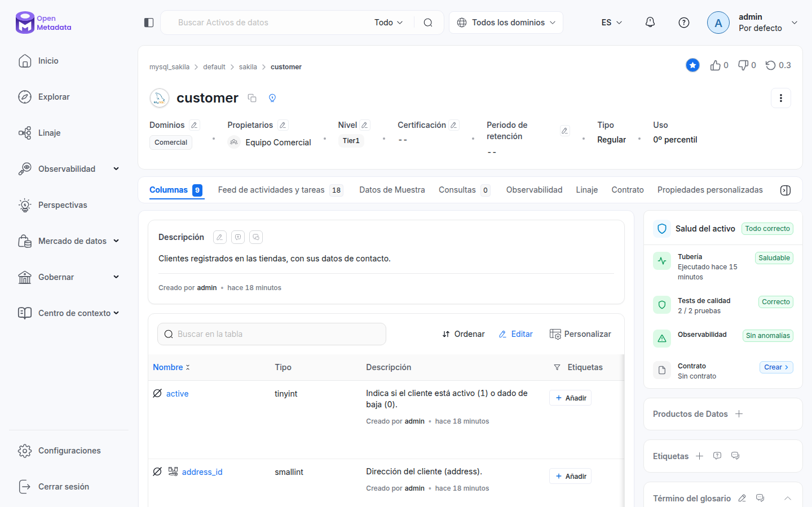

**Comprobación:** `./91_e2e_verificar.sh doc` -> las líneas de la fase 09 en PASS.

---

## Módulo 5. Clasificación de datos personales (PII)

**Objetivo:** identificar qué datos son personales o sensibles (clave en el RGPD).

**Conceptos**
- **PII** = *Personally Identifiable Information*: datos personales identificables.
- Un dato etiquetado `PII.Sensitive` no se puede usar libremente: requiere protección y tiene implicaciones legales.
- El **Tier** indica la **criticidad** de un activo (Tier1 = más crítico).

Etiquetar permite identificar datos sensibles, aplicar políticas de acceso, auditar su uso y facilitar el
cumplimiento legal.

**Hazlo a mano** (sobre `clientes`)
1. Entra en la ficha de la tabla -> pestaña **Columnas**.
2. En la columna `email`, pulsa el lápiz de **Tags** y elige `PII` -> `Sensitive`.
3. Haz lo mismo con `nombre`.
4. En la parte derecha de la ficha, asigna un **Tier** a la tabla.

**Atajo con script**
```bash
./10_gobierno_clasificacion.sh
```
Aplica `PII.Sensitive` a nombre, apellidos, email, dirección, teléfono, código postal, usuario y contraseña
(clientes, empleados, direcciones y vistas derivadas), `PII.NonSensitive` a los actores (personajes públicos)
y un Tier a cada tabla y vista.

**Qué mirar**
- Ficha de `customer`: columnas con tag `PII.Sensitive` y el Tier arriba a la derecha.
- **Explorar** -> filtros **Etiqueta** y **Nivel** (el Tier): ¿cuántos activos de nivel Tier1 hay? ¿cuáles contienen PII?
- **Gobernar -> Clasificación -> PII**: las etiquetas `None`, `NonSensitive` y `Sensitive` y los activos que las usan.


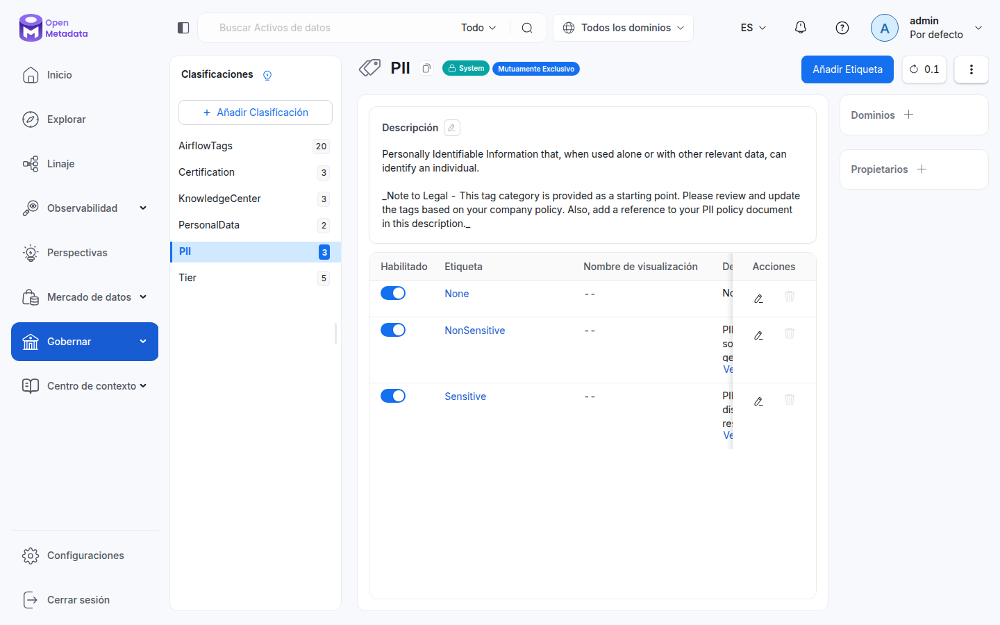

**Comprobación:** `./91_e2e_verificar.sh doc` -> fase 10 en PASS.

> **Pregunta:** ¿por qué `staff.password` es PII sensible aunque sea un hash?

---

## Módulo 6. Glosario de negocio

**Objetivo:** hablar el mismo idioma entre negocio y datos.

**Conceptos:** un **glosario** define los términos del negocio ("Cliente", "Alquiler"). Al asociarlos a tablas y
columnas, conectas el significado de negocio con el dato técnico.

**Hazlo a mano**
1. **Gobernar -> Glosario -> Añadir**.
   - Nombre: `Glosario Comercial`
   - Descripción: la que quieras
   - Guardar
2. **Añadir término**, tres veces:
   - `Cliente`: "Persona que ha realizado un registro o mantiene una relación comercial con la empresa."
   - `ID Cliente`: "Identificativo único de cliente."
   - `Email de Cliente`: "Dirección de correo electrónico utilizada para identificar y contactar con un cliente."
3. Ve a la tabla `clientes`. En la parte derecha, en **Término del glosario**, pulsa `+` y asocia `Cliente`.
4. En la columna `email` asocia el término `Email de Cliente`; en `id`, `ID Cliente`.

Con esto estás **añadiendo significado, clasificando datos y conectando negocio**.

**Atajo con script**
```bash
./11_gobierno_glosario.sh
```
Crea `Glosario Sakila` con 11 términos (Cliente, Alquiler, Película, Pago, Inventario, Empleado, Tienda, Actor,
Categoría, Idioma, Dirección) y los asocia a las 23 tablas/vistas y a sus identificadores.

**Qué mirar:** **Gobernar -> Glosario -> Glosario Sakila**, entra en un término y mira la pestaña de activos
asociados.

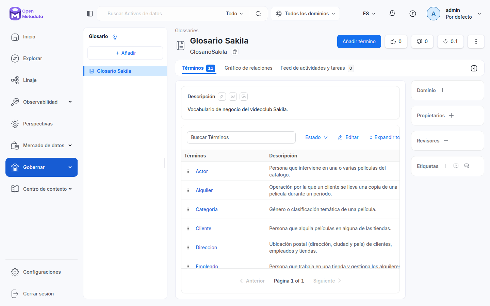

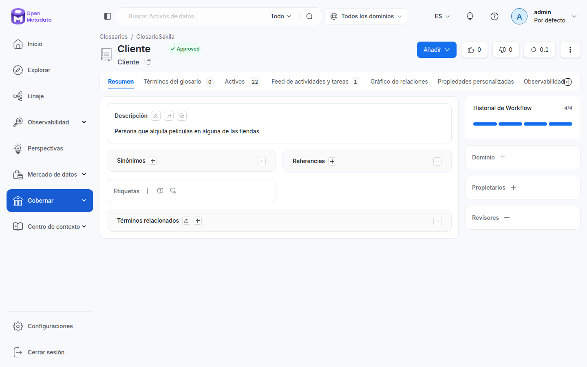

**Comprobación:** `./91_e2e_verificar.sh doc` -> fase 11 en PASS.

---

## Módulo 7. Propiedad y dominios

**Objetivo:** que cada dato tenga un responsable y pertenezca a un área de negocio.

**Conceptos**
- **Propietario**: usuario o **equipo** responsable del dato. Una tabla puede tener un equipo, o varios usuarios, pero
  no ambos mezclados.
- **Dominio**: agrupación por área de negocio (Comercial, Finanzas...).

**Hazlo a mano**
1. En la ficha de `clientes`, en **Propietarios**, pulsa el lápiz y pestaña **Usuarios**; elige `admin`.
2. Ya tienes un responsable asignado.
3. Opcional: **Configuraciones -> Miembros -> Equipos** para crear un equipo y asignarlo como propietario.

**Atajo con script**
```bash
./12_gobierno_propiedad.sh
```
Crea el equipo `Equipo Comercial` y el dominio `Comercial`, y los asigna a las 23 tablas y vistas.

**Qué mirar:** **Mercado de datos -> Dominios -> Comercial** (activos del dominio) y **Configuraciones -> Miembros ->
Equipos** (activos del equipo).

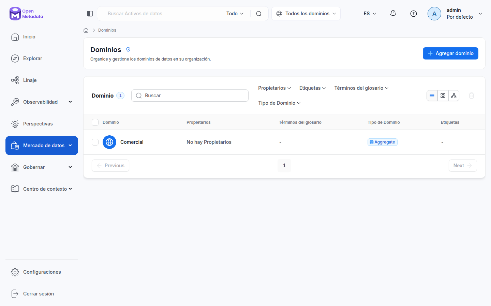

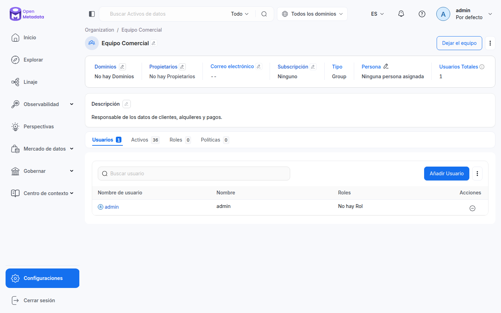

**Comprobación:** `./91_e2e_verificar.sh doc` -> fase 12 en PASS.

---

## Módulo 8. Calidad del dato

**Objetivo:** medir automáticamente si los datos cumplen las reglas esperadas.

**Conceptos**
- **Caso de prueba**: una regla sobre una tabla o columna (no nulo, único, rango, número de filas...).
- Los casos se agrupan en una **pipeline de calidad** que se ejecuta en Airflow (a demanda o programada).
- Resultados: `Success`, `Failed`, `Aborted`.

**Hazlo a mano** (sobre `clientes`)
1. **Observabilidad -> Tests de calidad -> pestaña Casos de Prueba -> Añadir caso de prueba**.
2. Elemento que probar: **Nivel de columna**; tabla `clientes`; columna `email`.
3. Tipo de prueba: **Column Values to Be Not Null**. Comprueba que se ha asignado un nombre.
4. En **Crear tubería**: nombre `test_calidad_clientes`, ejecución **bajo demanda**. Pulsa **Crear**.
5. Entra en la tabla -> **Observabilidad -> Calidad de datos**: verás el caso y la tubería.
6. En la pestaña **Tuberías**, tres puntos -> **Ejecutar**. Mira el log en **Registros**.
7. En **Casos de prueba**, el resultado debería ser **Fallido** (hay un cliente sin email).

**Atajo con script**
```bash
./13_gobierno_calidad.sh
```
Crea 6 casos sobre Sakila (no nulos, únicos, rangos, número de filas) y una pipeline por tabla.
El caso `address_address2_no_nulo` **falla a propósito** para que veas un fallo y su detalle (`nullCount`).

**Qué mirar**
- **Observabilidad -> Tests de calidad -> Casos de Prueba**: 5 `Success` y 1 `Failed`.
- En Airflow, los DAG `customer_calidad`, `payment_calidad`, `film_calidad` y `address_calidad`.

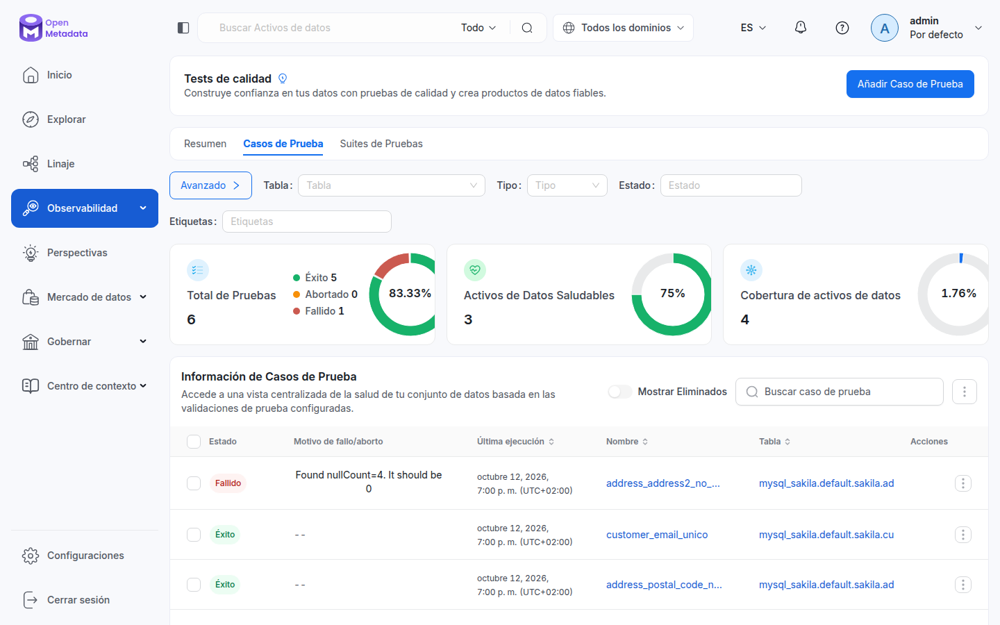


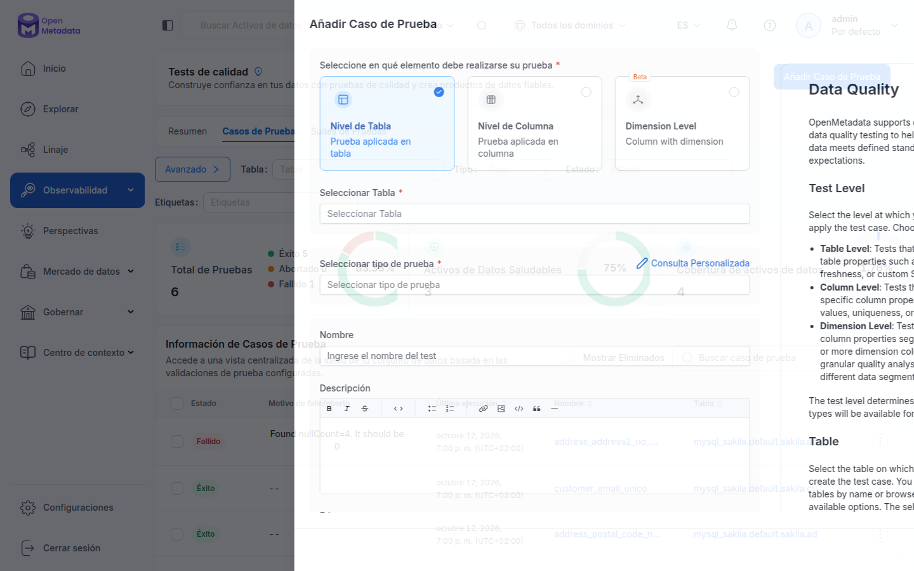

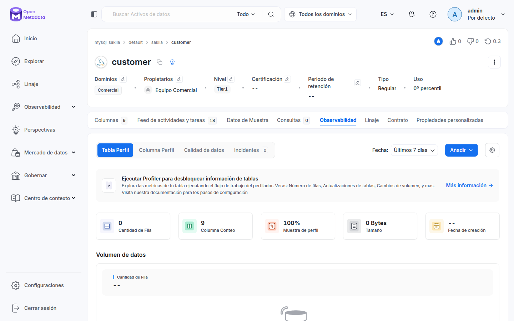

En la ficha de la tabla, la pestaña **Observabilidad** tiene las subpestañas *Tabla Perfil*, *Columna Perfil*,
*Calidad de datos* e *Incidentes*.

**Comprobación:** `./91_e2e_verificar.sh 13` -> 1 PASS.

> **Pregunta:** el test falla porque `address2` es opcional. ¿Es un problema de datos o de la regla?

---

## Módulo 9. Linaje

**Objetivo:** ver de dónde vienen los datos y qué se ve afectado si cambian.

**Conceptos**
- **Linaje**: grafo de dependencias entre activos (tabla -> vista, tabla -> tabla derivada, tabla -> pipeline).
- Puede ser a nivel de **tabla** o de **columna**.
- Responde a "¿de dónde sale este dato?" y a "¿qué se rompe si toco esto?" (análisis de impacto).

El linaje se puede obtener de tres formas, y este módulo recorre las tres:

| Forma | Cuándo | Script |
|---|---|---|
| **Automática desde vistas** | OpenMetadata lee el SQL de la vista y deduce sus orígenes | `15` |
| **Declarada por API o a mano** | Tablas derivadas por SQL, que el catálogo no puede deducir solo | `16` |
| **A través de una pipeline real** | Un ETL en Airflow que carga un almacén de datos | `17` + `22` |

### 9.1 Linaje automático desde las vistas

```bash
./15_gobierno_linaje_vistas.sh
```
Crea una pipeline de tipo `lineage` (DAG `mysql_sakila_lineage` en Airflow). **Qué mirar:** ficha de `customer_list`
-> pestaña **Linaje**: depende de `customer`, `address`, `city` y `country`. Mira también `sales_by_store`: tiene 8 orígenes.

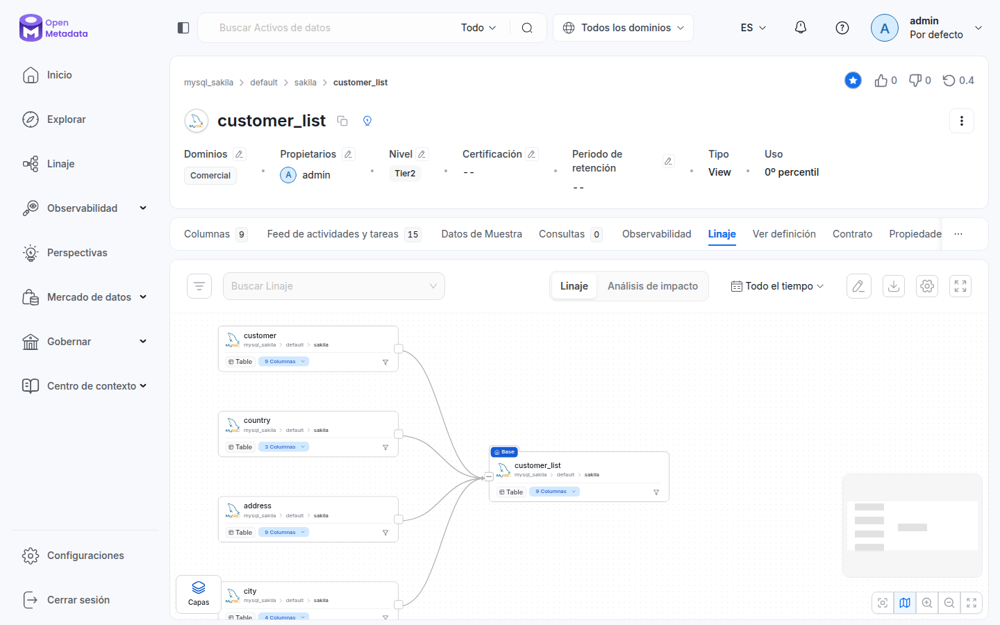


> Importante: el linaje de vistas **no** lo genera la ingestión de metadatos, sino esta pipeline propia.

### 9.2 Linaje de una tabla derivada

```bash
./16_gobierno_linaje_derivada.sh
```
Crea `resumen_ventas_cliente` con un `CREATE TABLE ... AS SELECT` sobre `customer`, `rental` y `payment`, la ingesta
y **declara** su linaje a nivel de columna (`payment.amount` -> `total_pagado`). Además le aplica gobierno (Tier,
glosario, propietario y PII en `nombre` y `email`).

**Hazlo a mano:** en la ficha de la tabla -> **Linaje** -> botón de editar -> arrastra aristas entre tablas.

**Qué mirar:** ficha de `resumen_ventas_cliente` -> **Linaje** y activa la vista de **columnas**.

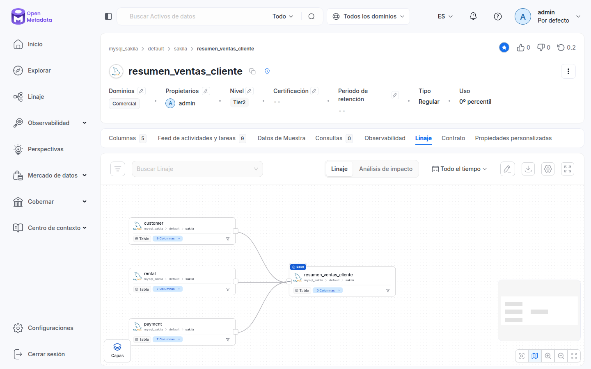


### 9.3 Un ETL real y linaje entre servicios

El linaje de la pestaña principal solo dibuja flechas **entre servicios distintos**. Por eso añadimos un segundo
servicio, un almacén de datos, y lo cargamos con un ETL real:

```bash
./17_gobierno_almacen_servicio.sh    # prepara el esquema dwh_sakila y registra el servicio mysql_dwh
./22_gobierno_linaje_etl.sh          # ETL real en Airflow + linaje a través de la pipeline
```
El `22` despliega el DAG [`dags/etl_sakila_dwh.py`](dags/etl_sakila_dwh.py) en Airflow, lo ejecuta (carga
`dim_cliente` con 599 filas y `fact_pagos` con 16.044), registra Airflow como servicio de pipelines y enlaza
el linaje de las tablas a través de la pipeline.

Abre el DAG: es un ETL de verdad (programado cada hora, con reintentos, dos tareas en paralelo). Cada tarea
declara con `inlets` y `outlets` qué tablas lee y escribe.

**Qué mirar**
- **Explorar -> Tuberías -> `etl_sakila_dwh`** (o la ficha directa): pestañas *Tareas*, *Ejecuciones* y *Linaje*.
- Linaje de `dim_cliente`: `customer` -> pipeline -> `dim_cliente`.
- **Linaje** (menú principal) -> vista **Servicio**: flecha `mysql_sakila` -> `mysql_dwh`.
- En Airflow: DAG `etl_sakila_dwh` -> Runs -> log de `carga_dim_cliente` ("599 filas").

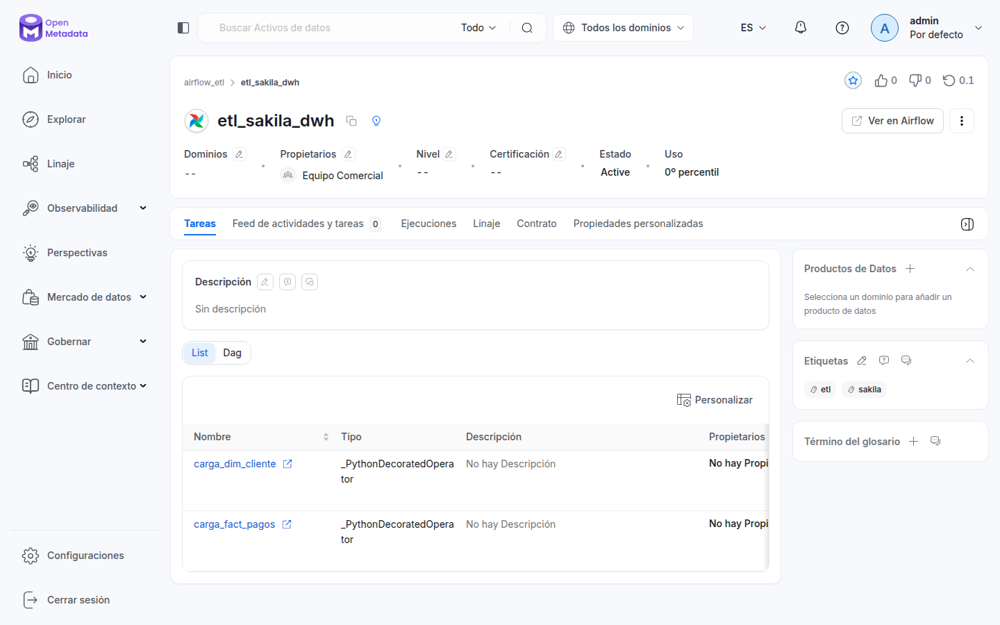

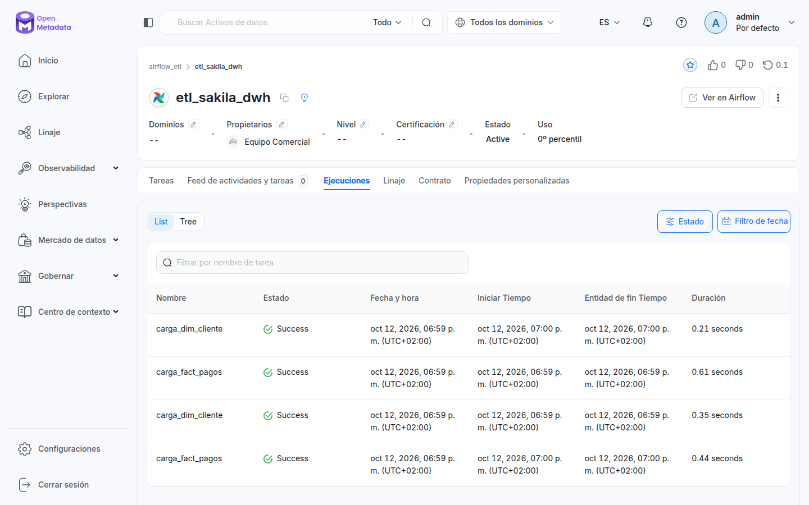

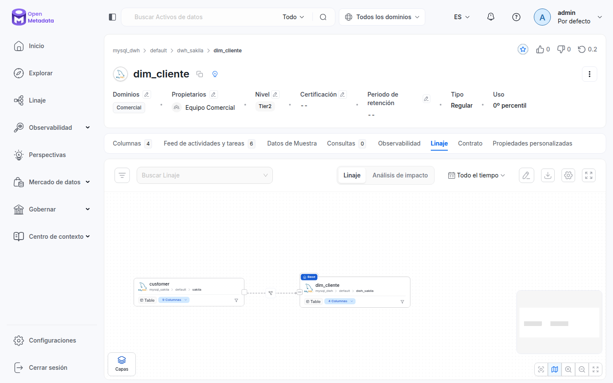

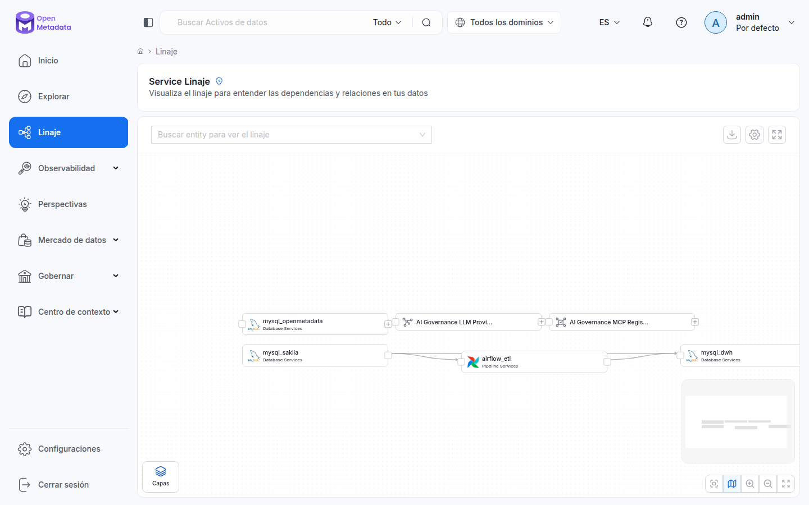

> **Nota honesta:** con esta conexión de Airflow, OpenMetadata no deduce solo el linaje de los `inlets`/`outlets`
> del DAG. El script **lo declara por API** apuntando a la pipeline. En el grafo se ve igual; la pipeline y sus
> ejecuciones sí vienen de Airflow.

**Comprobación:** `./91_e2e_verificar.sh 15 16 17 22` -> todo en PASS.

> **Pregunta:** si cambias el nombre de la columna `customer.email`, ¿qué activos se ven afectados? Usa el linaje.

---

## Módulo 10. Uso diario: la portada y el Centro de contexto

**Objetivo:** ver cómo se usa el catálogo día a día y qué muestra la portada.

**Conceptos**
- **Mis datos**: activos de los que eres propietario.
- **Activos seguidos**: los que sigues para recibir cambios.
- **Centro de contexto**: artículos y documentos vinculados a los activos (guías, políticas).
- **KPI** y **Total de activos**: métricas de cobertura de gobierno, calculadas por la aplicación **Data Insights**.

```bash
./21_uso_todo.sh      # lanza los tres siguientes
```

| Script | Widget de la portada | Qué hace |
|---|---|---|
| `18_uso_activos_seguidos.sh` | Activos seguidos y Mis datos | `admin` sigue 10 activos y pasa a ser propietario directo de 5 activos analíticos |
| `19_uso_centro_contexto.sh` | Centro de contexto | Publica 3 artículos (guía de Sakila, política PII, calidad del dato) vinculados a las tablas |
| `20_uso_kpi_insights.sh` | KPI y Total de activos | Crea 2 KPI (cobertura de descripciones y de propietarios) y ejecuta Data Insights |

**Qué mirar:** la **portada** (**Inicio**) con sus widgets, **Centro de contexto -> Artículos** en el menú lateral y
los paneles de **Perspectivas**.

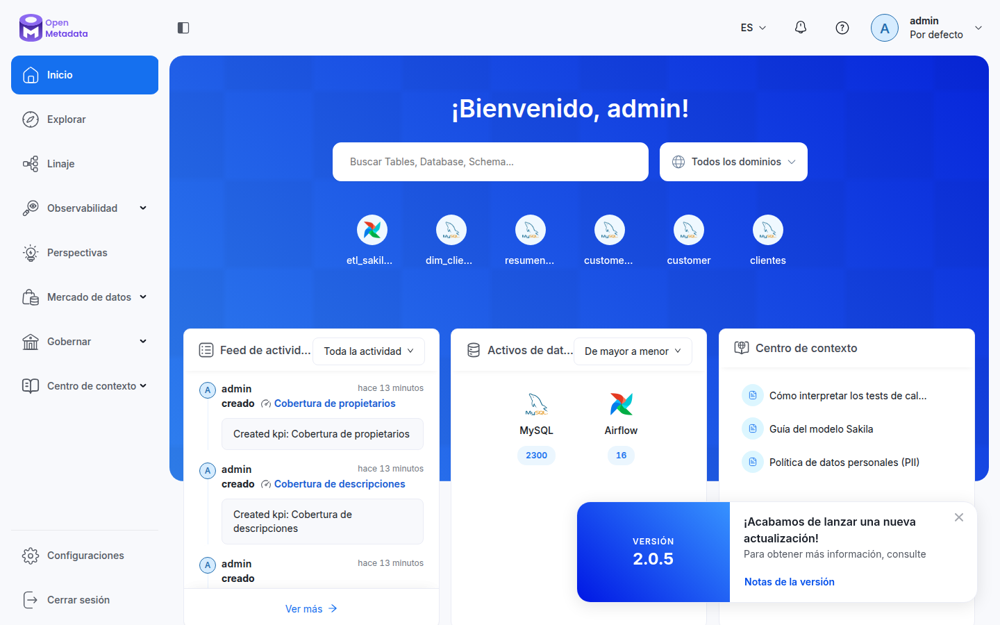

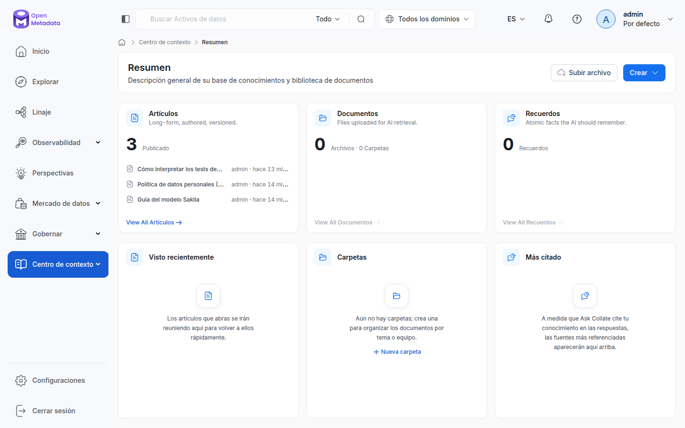

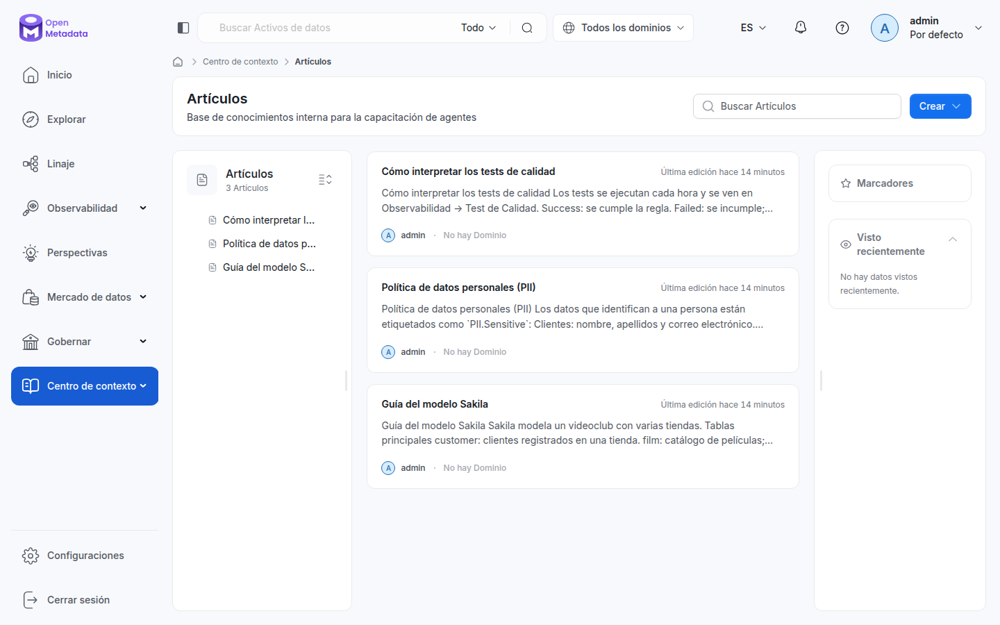

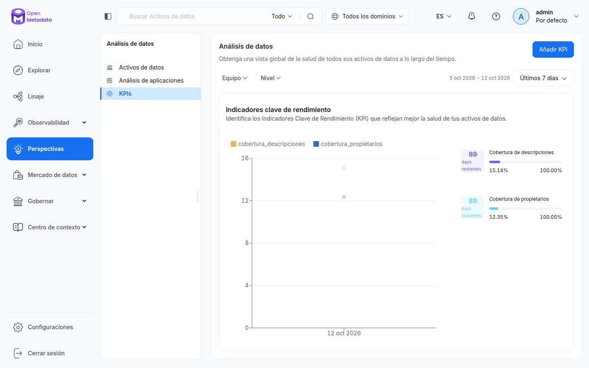

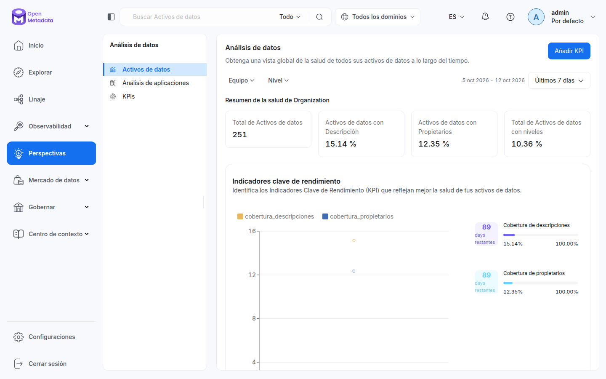

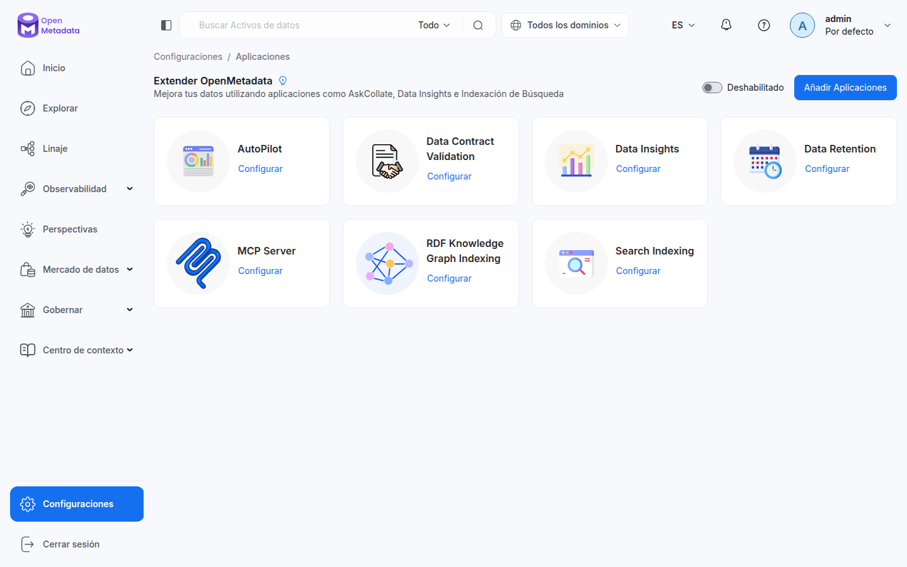


**Notas**
- Data Insights solo se ejecuta por defecto a las 03:00, por eso KPI y Total de activos están vacíos hasta lanzarla;
  el script `20` la ejecuta. Su historial: **Configuraciones -> Aplicaciones -> Data Insights**. Los paneles completos (KPI,
  Total de activos de datos, porcentaje con descripción y con propietario) están en el menú **Perspectivas**.
- Si no ves los cambios, haz un **refresco fuerte (Ctrl+F5)**: la portada cachea usuario e índice de búsqueda.
- En los activos de "Mis datos" el propietario pasa de equipo a usuario, porque no se pueden mezclar.

**Comprobación:** `./91_e2e_verificar.sh uso` -> 4 PASS.

---

## Módulo 11. Airflow: cuándo mirarlo y dónde

Airflow (http://localhost:8080, `admin` / `admin`) es quien ejecuta realmente las ingestas, los tests de calidad
y el ETL. Cada paso que lance algo aparece como un DAG:

| Después de... | DAG en Airflow | Qué deberías ver |
|---|---|---|
| `07` | `mysql_openmetadata_metadata` | Una ejecución en verde (`success`) |
| `08`, `16` | `mysql_sakila_metadata` | Una ejecución por ingesta (la `16` relanza una al crear la tabla derivada) |
| `13` | `customer_calidad`, `payment_calidad`, `film_calidad`, `address_calidad` | Un DAG por tabla con tests, cada hora |
| `15` | `mysql_sakila_lineage` | Ejecución que genera el linaje de las vistas |
| `17`, `22` | `mysql_dwh_metadata` | Ingesta del almacén (en la `22`, tras cargar las tablas) |
| `22` | `etl_sakila_dwh` | **El ETL**: `carga_dim_cliente` y `carga_fact_pagos`, cada hora |
| `22` | `airflow_etl_metadata` | Ingesta que trae a OpenMetadata la pipeline `etl_sakila_dwh` |

**Cómo recorrerlo en la consola de Airflow** (interfaz en español; lo comprobado con Chrome en Airflow 3.3)
1. Menú lateral **Dags**: lista con el estado, la última ejecución y la siguiente. Verás además los DAG de ejemplo de
   OpenMetadata (`sample_data`, `sample_lineage`, `sample_usage`...), que están **pausados**: ignóralos.
2. Entra en el DAG. Arriba verás *Programación*, *Última ejecución*, *Siguiente ejecución* y *Propietario*, y las
   pestañas **Resumen, Ejecuciones, Tareas, Calendario, Backfills, Auditoría de Log, Código y Detalles**.
3. Pestaña **Ejecuciones**: cada fila es una ejecución (*Exitoso*, *En ejecución*, *Fallido*) y su tipo (*Manual* o
   *Programado*). Pulsa una.
4. Dentro de la ejecución, pestaña **Instancias de Tarea**: pulsa la tarea para abrirla.
5. Pestaña **Logs** de la tarea: el detalle de la ejecución. En `etl_sakila_dwh` verás `dim_cliente: 599 filas`.
6. Botón **Trigger** (arriba a la derecha) lanza el DAG a mano; el interruptor junto al nombre lo pausa o activa.

Fíjate en **Intentos de Tarea** (encima del log): si una tarea falló y se reintentó, aparecen varios intentos
(`1 ❌`, `2 ✅`). Un reintento que "salva" una ejecución puede ocultar un problema real: revisa siempre el intento 1.
(`etl_sakila_dwh` tiene `max_active_runs=1` precisamente para evitar que dos ejecuciones simultáneas choquen.)

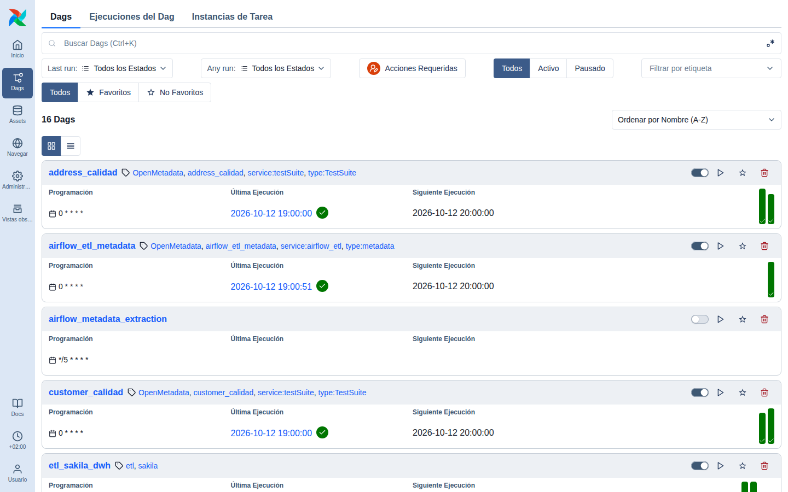

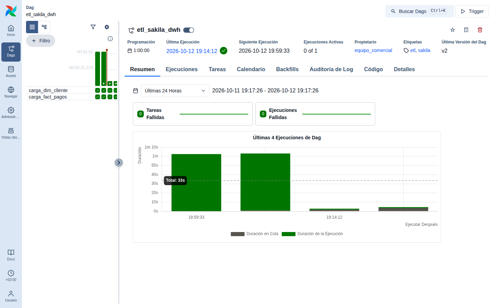

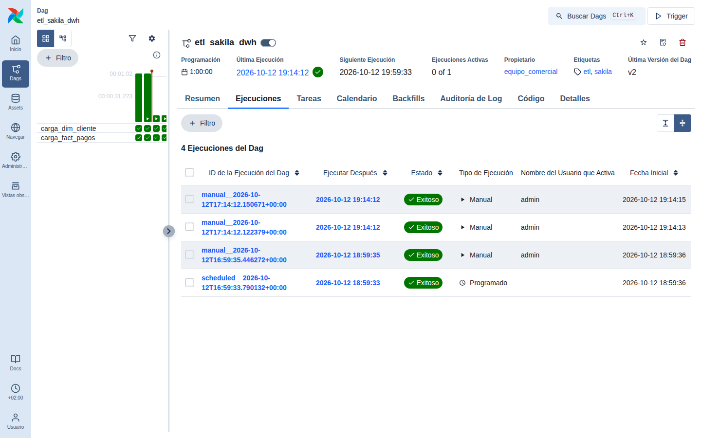

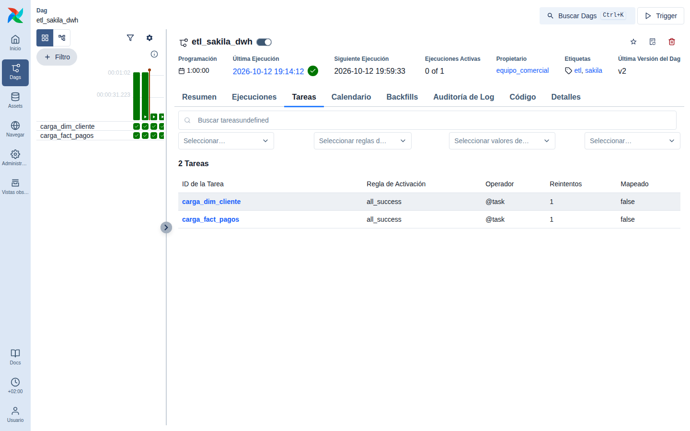

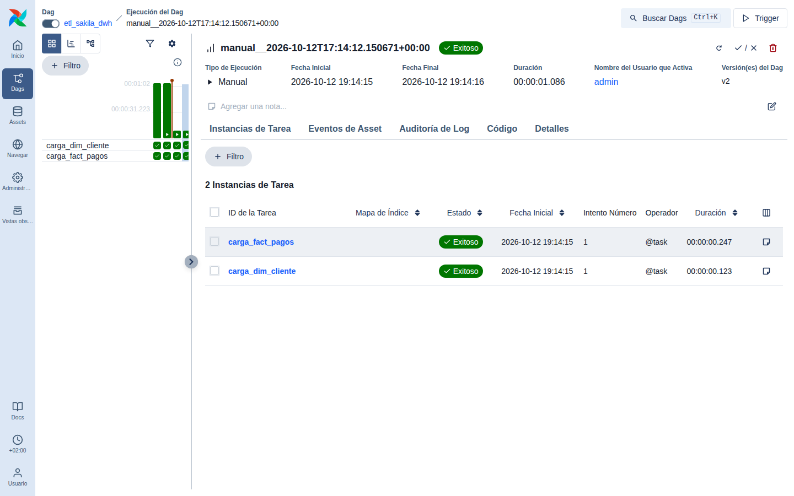

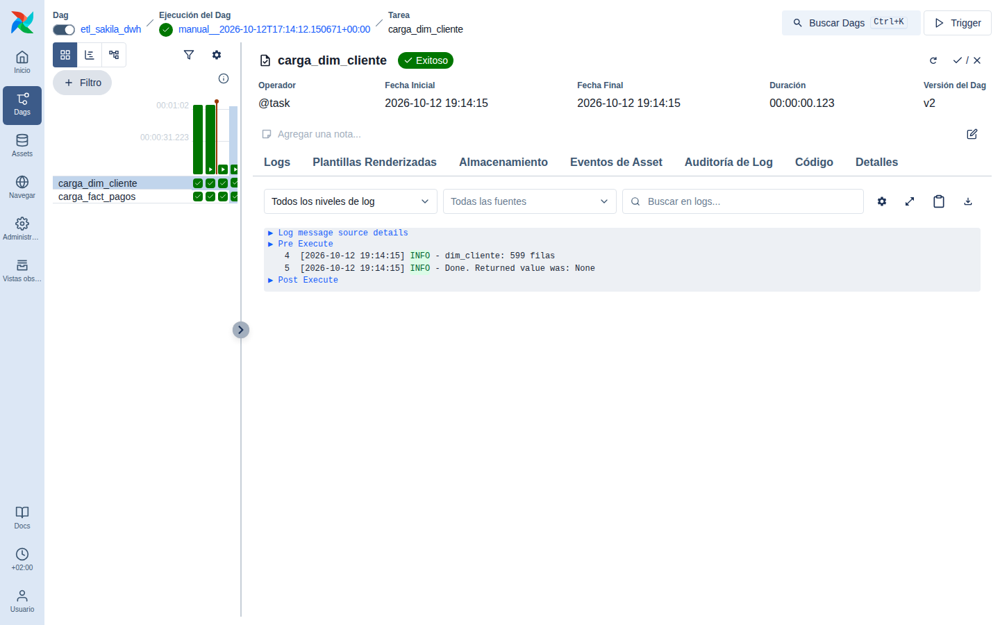

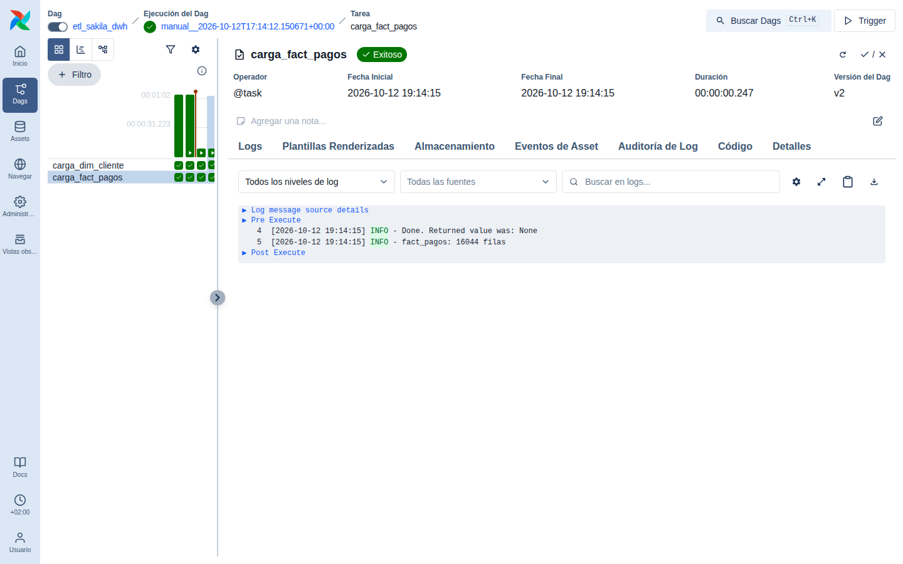

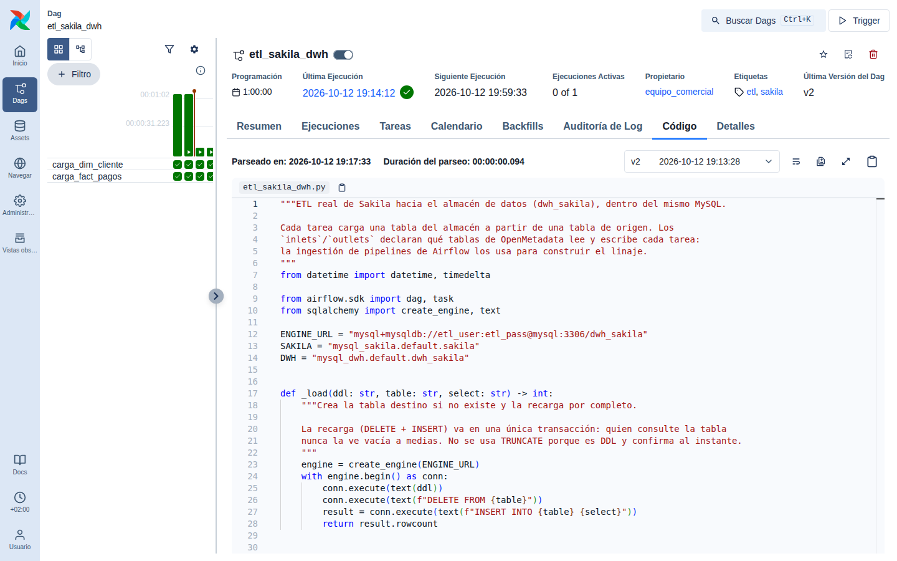

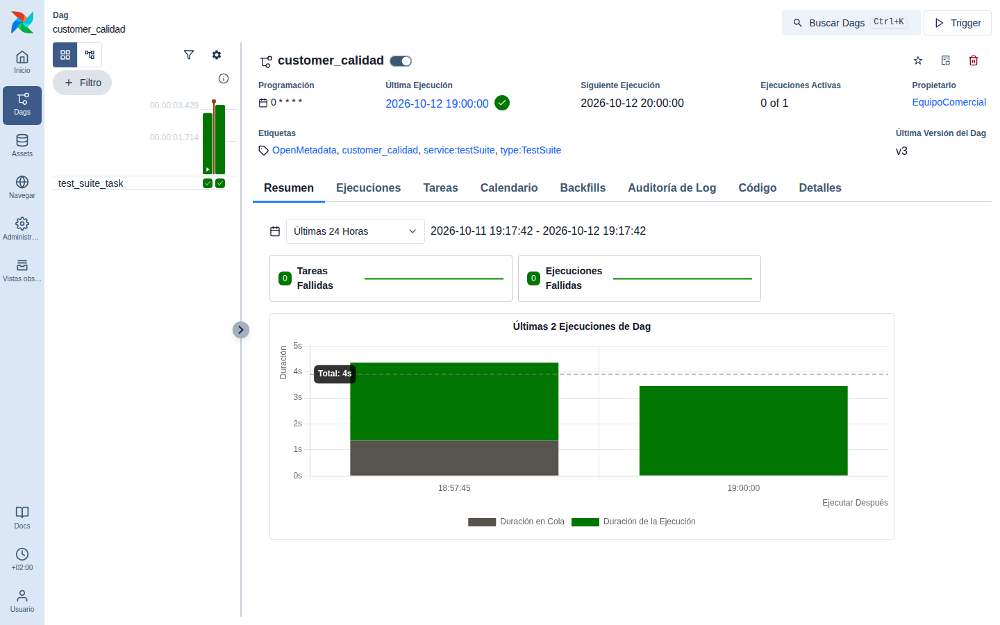

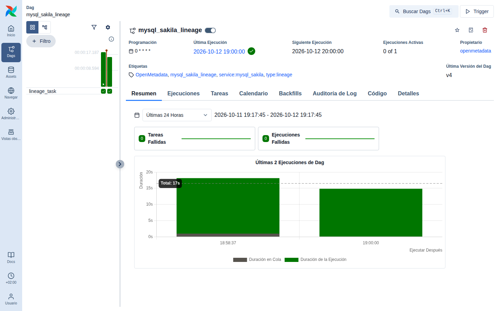

**Lo mismo desde OpenMetadata**, sin entrar en Airflow: **Configuraciones -> Servicios -> (tipo) -> el servicio ->
pestaña Agentes**: estado de cada pipeline y botón de logs.

**Lo que no pasa por Airflow**
- **Data Insights**: Configuraciones -> Aplicaciones -> Data Insights.
- **Reindexado de búsqueda**: Configuraciones -> Aplicaciones -> Search Indexing.

---

## Módulo 12. Automatización y prueba E2E

**Objetivo:** reproducir todo el laboratorio de una vez y verificarlo.

| Script | Qué hace |
|---|---|
| `./14_gobierno_todo.sh` | Aplica las fases de gobierno (09-13, 15-17 y 22) en orden |
| `./21_uso_todo.sh` | Lanza los scripts de uso de la portada (18 a 20) |
| `./91_e2e_verificar.sh [fase...]` | Verifica por API lo que debería existir. Solo lectura |
| `./90_e2e.sh` | Recorrido completo desde cero: destruye, levanta, aplica todo y verifica |

`./90_e2e.sh` **borra los datos** (`docker-volume/db-data` y volúmenes), tarda unos 10-12 minutos y deja todo en
`e2e.log` (`tail -f e2e.log`). Última comprobación: 29 verificaciones, todas en PASS.

**Fases del verificador:** `07`, `08`, `doc` (09-12), `13`, `15`, `16`, `17`, `22`, `uso` (18-20).

### Mapa del menú (comprobado con Chrome en OpenMetadata 2.0.5, idioma español)

| Menú lateral | Contiene |
|---|---|
| Inicio | Portada: Feed de actividades, Activos de datos, Centro de contexto, Mis Datos, KPI |
| Explorar | Búsqueda y navegación de activos |
| Linaje | Linaje de plataforma, vista **Servicio** |
| Observabilidad | Tests de calidad (pestañas Resumen, Casos de Prueba, Suites de Pruebas), Gestor de Incidentes, Alertas, Biblioteca de Pruebas |
| Perspectivas | Paneles de Data Insights (KPI, Total de activos de datos, descripciones y propietarios) |
| Mercado de datos | Resumen, **Dominios**, Productos de Datos |
| Gobernar | **Glosario**, Explorador de Ontología, **Clasificación**, Métricas, Operaciones Masivas de Columnas, Flujos de Trabajo |
| Centro de contexto | Resumen, **Artículos**, Documentos, Recuerdos, Archivo |
| Configuraciones | Servicios, Miembros (Equipos, Usuarios), Aplicaciones... |

Pestañas de la ficha de una **tabla**: Columnas, Feed de actividades y tareas, Datos de Muestra, Consultas,
Observabilidad, **Linaje**, Contrato, Propiedades personalizadas. En la ficha de un **servicio**: Agentes
(ahí están las pipelines de ingestión), Bases de datos, Conexión y Perspectivas.

### Qué se mete y dónde se ve (resumen del recorrido)

| Paso | Script | Qué se mete | Dónde verlo en la consola (http://localhost:8585) | Resultado esperado |
|---|---|---|---|---|
| 1 | `01_launch.sh` | Stack completo | Airflow en http://localhost:8080 | Ambos responden |
| 2 | `06`, `07` | Tabla `clientes` y servicio `mysql_openmetadata` | Configuraciones -> Servicios; Explorar | `clientes` con 5 filas |
| 3 | `08` | Sakila y servicio `mysql_sakila` | Explorar -> `mysql_sakila` -> `sakila` | 23 tablas y vistas |
| 4 | `09` | Descripciones | Ficha de la tabla -> Columnas | Todas con descripción |
| 5 | `10` | `PII.Sensitive` y Tier | Ficha de la tabla; Explorar -> filtros Etiqueta / Nivel; Gobernar -> Clasificación | Tier en las 23; PII donde toca |
| 6 | `11` | Glosario y términos | Gobernar -> Glosario | 11 términos, asociados a las 23 |
| 7 | `12` | Equipo y dominio | Mercado de datos -> Dominios; Configuraciones -> Miembros -> Equipos | Propietario y dominio en las 23 |
| 8 | `13` | Tests de calidad | Observabilidad -> Tests de calidad | 5 Success y 1 Failed |
| 9 | `15` | Linaje desde las vistas | Ficha de la vista -> Linaje | 7 vistas con orígenes |
| 10 | `16` | Tabla derivada | `resumen_ventas_cliente` -> Linaje | 3 orígenes y linaje de columna |
| 11 | `17` | Servicio `mysql_dwh` | Configuraciones -> Servicios | Servicio creado |
| 12 | `22` | ETL real | Explorar -> Tuberías; Airflow -> Dags | 599 y 16.044 filas; linaje por la pipeline |
| 13 | `21` | Uso de la portada | Inicio, Centro de contexto -> Artículos, Perspectivas | 10 seguidos, 5 propios, 3 artículos, 2 KPI |

---

## Módulo 13. Ejercicios finales

Resuélvelos en la consola, sin scripts.

1. **Documentación.** En el servicio `mysql_openmetadata` localiza tablas internas sin descripción (por ejemplo
   `table_entity`) y documenta una.
2. **Clasificación.** ¿Hay alguna columna con datos personales que no esté etiquetada? Revisa `address`,
   `film_list` y `customer_list`.
3. **Glosario.** Crea el término "Alquiler activo" y asócialo a `rental.return_date`. ¿Qué significa que sea `NULL`?
4. **Propiedad.** Crea un segundo equipo ("Equipo de Datos") y asígnalo como propietario de `dim_cliente`.
5. **Calidad.** Añade un test de unicidad sobre `payment.payment_id` y otro de rango sobre `film.length`.
   Programa uno de ellos para que se ejecute cada día.
6. **Linaje e impacto.** Si eliminaras la columna `customer.email`, ¿qué activos se verían afectados?
7. **Airflow.** Pausa el DAG `etl_sakila_dwh`, lánzalo a mano y localiza en el log cuántas filas cargó cada tarea.
8. **Integración.** Una auditoría pide "todos los activos con datos personales de clientes, con su propietario y
   su calidad". ¿Cómo lo obtienes en OpenMetadata?

---

## Módulo 14. Solución de problemas y referencia

### Solución de problemas

| Síntoma | Causa probable | Solución |
|---|---|---|
| Un widget de la portada sale vacío | Caché de la UI o falta ejecutar Data Insights | Ctrl+F5; ejecuta `./20_uso_kpi_insights.sh` |
| La tabla no aparece tras una ingesta | La pipeline aún no ha terminado | Mira el DAG en Airflow o el estado en Configuraciones -> Servicios |
| `08` falla al cargar | El stack no está sano | `./02_ps.sh`; espera a que todos estén `healthy` |
| El DAG `etl_sakila_dwh` no aparece | Airflow aún no ha escaneado la carpeta | Espera ~30 s (el compose lo fija con `AIRFLOW__DAG_PROCESSOR__REFRESH_INTERVAL`) |
| Error `Rule [Multiple Users or Single Team Ownership]` | Mezclas equipo y usuarios como propietarios | Un equipo, o varios usuarios, pero no ambos |
| El puerto 8585 u 8080 está ocupado | Otro servicio local | Libera el puerto y relanza `./01_launch.sh` |
| Quiero empezar de cero | - | `./99_destroy.sh` y vuelve al módulo 0 |

### Referencia de scripts

| Rango | Scripts | Para qué |
|---|---|---|
| 01-05 | `01_launch`, `02_ps`, `03_logs`, `04_open_openmetadata`, `05_open_airflow` | Operar el entorno |
| 06-08 | `06_create_clientes_table`, `07_ingest_mysql`, `08_load_sakila` | Datos y servicios |
| 09-13 | `09_..documentacion`, `10_..clasificacion`, `11_..glosario`, `12_..propiedad`, `13_..calidad` | Gobierno del dato |
| 14 | `14_gobierno_todo` | Todas las fases de gobierno |
| 15-17, 22 | `15_..linaje_vistas`, `16_..linaje_derivada`, `17_..almacen_servicio`, `22_..linaje_etl` | Linaje |
| 18-21 | `18_uso_activos_seguidos`, `19_uso_centro_contexto`, `20_uso_kpi_insights`, `21_uso_todo` | Uso de la portada |
| 90-91 | `90_e2e`, `91_e2e_verificar` | Prueba E2E |
| 99 | `99_destroy` | Borrado total |

### Ficheros de apoyo

- `compose.yaml`: el stack (MySQL, Elasticsearch, OpenMetadata, Airflow).
- `om_lib.py`: funciones comunes de los scripts (login, parches JSON, catálogo de las 23 tablas).
- `dags/etl_sakila_dwh.py`: el DAG del ETL real.
- `capturas/`: capturas de pantalla de cada paso, con nombre `MÓDULO-PASO-descripcion.png`.
- `capturas.py`: regenera las capturas con un Chrome real (`python3 capturas.py [filtro]`). Requiere el laboratorio
  poblado y `pip install playwright`.
- `e2e.log`: registro de la última prueba E2E (no se versiona).

### Índice de capturas

Todas están en la carpeta [`capturas/`](capturas/), ordenadas por módulo y paso:

| Módulo | Capturas |
|---|---|
| 0 Arranque | `00-01`, `00-02` (login), `00-03` (portada) |
| 2 Primer catálogo | `02-01` servicios, `02-02` agentes, `02-03` tabla `clientes`, `02-04` asistente |
| 3 Sakila | `03-01` explorar, `03-02` tabla, `03-03` vista |
| 4 Documentación | `04-01` columnas con descripción |
| 5 Clasificación | `05-01` columnas PII, `05-02` etiquetas PII |
| 6 Glosario | `06-01` glosario, `06-02` término |
| 7 Propiedad | `07-01` dominios, `07-02` equipo |
| 8 Calidad | `08-01` resumen, `08-02` casos, `08-03` observabilidad, `08-04` nuevo caso |
| 9 Linaje | `09-01` vista, `09-02` derivada, `09-03` almacén, `09-04` servicios, `09-05`/`09-06` pipeline |
| 10 Uso | `10-01` portada, `10-02`/`10-03` centro de contexto, `10-04`/`10-05` perspectivas, `10-06` aplicaciones |
| 11 Airflow | `11-01` a `11-10` |
